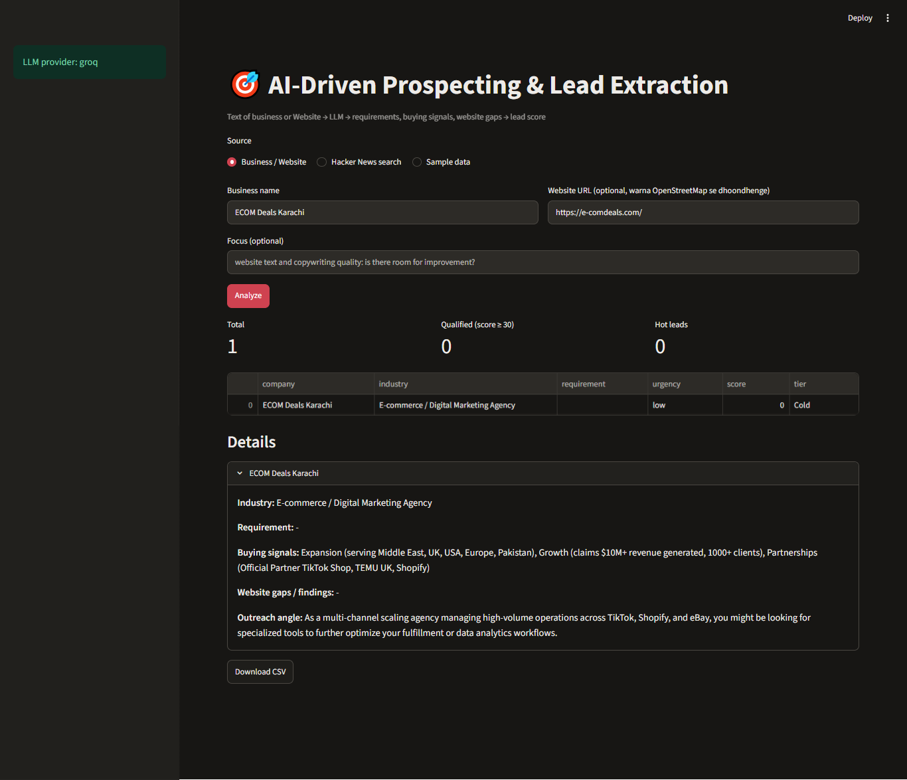
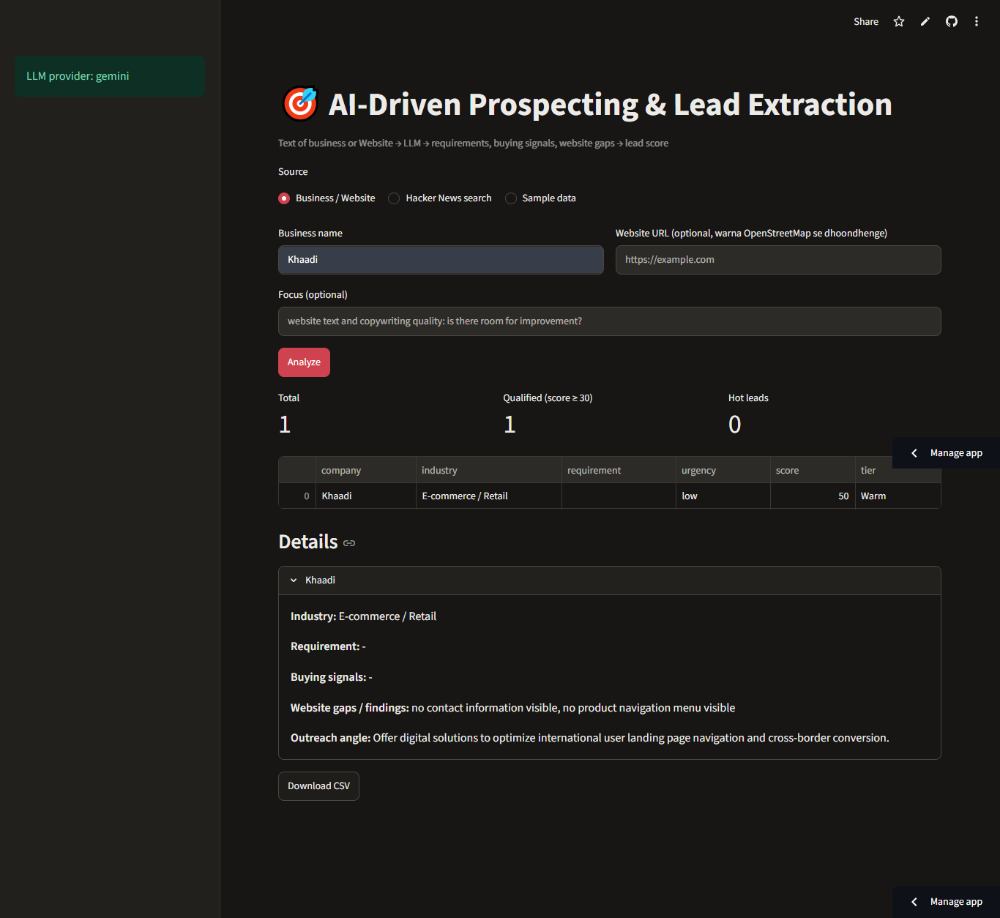

# 🎯 AI-Driven Prospecting & Lead Generation System

**An AI-powered B2B prospecting and lead extraction system that identifies business requirements, detects buying signals, analyzes website gaps, and prioritizes potential leads through intelligent scoring.**

---

## 💡 Business Development & Sales Learning Outcomes

### Beyond Coding: Understanding the Business Value of AI-Driven Prospecting

The primary purpose of this project goes beyond building a Python-based application. It demonstrates how AI can support modern Business Development and Sales professionals in identifying, understanding, and prioritizing potential business opportunities.

From a Business Development Executive (BDE) or Sales Associate perspective, this project highlights several important professional skills and business concepts:

**1. Identifying Potential Customers (Prospecting)**

Learn how to discover potential customers by analyzing business websites, online discussions, and publicly available business information rather than relying entirely on manual searching.

**2. Understanding Customer Pain Points**

Recognize what businesses actually need, what challenges they are facing, and where their existing solutions may be falling short.

**3. Recognizing Buying Signals**

Identify indicators such as approved budgets, urgent requirements, hiring activities, expansion plans, and deadlines that may suggest a potential buying opportunity.

**4. Lead Qualification & Prioritization**

Understand why every prospect is not necessarily a qualified lead. Use lead scoring to distinguish between Cold, Warm, and Hot prospects and prioritize opportunities that deserve attention.

**5. Personalized Sales Outreach**

Move beyond generic sales pitches by understanding a prospect's requirements and identifying relevant outreach angles that can support meaningful business conversations.

**6. AI-Driven Decision Support**

Understand how Generative AI and Large Language Models can transform unstructured business information into actionable insights, helping sales professionals make more informed prospecting decisions.

### 🎯 The Key Takeaway

This project demonstrates an important lesson in modern sales:

**Successful prospecting is not about contacting more businesses; it is about identifying the right businesses, understanding their needs, recognizing their buying intent, and approaching them with the right solution.**

AI can make this process more structured, insightful, and efficient, while human judgment, communication, relationship-building, and business understanding remain essential to successful sales and business development.


## 🚀 Project Overview

AI-Driven Prospecting & Lead Generation System is a Python-based application designed to help sales teams and businesses identify potential customers and uncover business opportunities.

The system collects business information from different sources, processes the collected data using Large Language Models (LLMs), extracts meaningful sales insights, and generates a structured list of qualified leads.

It supports multiple AI providers, including **Google Gemini, Groq, and Anthropic Claude**, with an offline rule-based fallback mechanism.

The project provides both an interactive Streamlit web interface and a command-line execution pipeline.

## ✨ Key Features

- **AI-Powered Lead Extraction:** Identifies business requirements and potential customer needs using LLMs.
- **Multiple AI Providers:** Supports Google Gemini, Groq, and Anthropic Claude.
- **Business Website Analysis:** Extracts website content and identifies visible business website gaps.
- **Buying Signal Detection:** Identifies urgency, budget, hiring, expansion, deadlines, and other buying indicators.
- **Lead Scoring & Qualification:** Assigns scores and categorizes leads into Cold, Warm, and Hot tiers.
- **Multiple Data Sources:** Supports business websites, Hacker News search, sample datasets, and authorized REST API integration through the CLI.
- **Automatic Provider Fallback:** Attempts other available AI providers when the selected provider fails.
- **Response Caching:** Reduces repeated API calls by caching previously analyzed results.
- **Offline Mode:** Provides basic keyword-based analysis without requiring an AI API key.
- **CSV Export:** Allows users to download qualified lead data for further analysis.

## 🧠 How It Works

The application follows a structured data-processing pipeline:

1. **Data Collection:** Collects business information from websites, Hacker News, or sample datasets.
2. **Content Extraction:** Retrieves and cleans website or post content.
3. **AI Analysis:** Processes the collected information through the selected LLM provider.
4. **Insight Extraction:** Identifies industry, business requirements, buying signals, urgency, and website gaps.
5. **Lead Scoring:** Calculates lead scores and assigns qualification tiers.
6. **Data Visualization:** Displays results through an interactive Streamlit dashboard.
7. **Export:** Generates downloadable CSV reports.

## 📊 Lead Scoring System

The system evaluates potential leads based on their requirements, urgency, buying signals, and identified website opportunities.

| Lead Category | Score |
|---|---:|
| Cold | 0–29 |
| Warm | 30–59 |
| Hot | 60–100 |

**Qualification Criteria:**
- Leads scoring 30 or above are considered qualified.
- Website-based opportunities are scored according to identified website gaps.
- Post-based leads are scored using requirements, urgency, and buying signals.

## 🛠️ Technology Stack

| Category | Technologies |
|---|---|
| Programming Language | Python |
| Frontend / UI | Streamlit |
| Data Processing | Pandas |
| AI / LLM Integration | Google Gemini, Groq, Anthropic Claude |
| HTTP Requests | Requests |
| Configuration Management | Python-dotenv |
| Data Storage / Caching | JSON |
| Data Export | CSV |
| Business Discovery | OpenStreetMap Nominatim |
| External Data Source | Hacker News Algolia API |
| Deployment | Streamlit Community Cloud |
| Version Control | Git & GitHub |

## 📁 Project Structure

```text
AI-Driven-Prospecting-Lead-Generation/
│
├── app.py
├── main.py
├── extractor.py
├── sources.py
├── analytics.py
├── list-models.py
│
├── data/
│   └── sample_listings.json
│
├── requirements.txt
├── .env
├── .gitignore
└── README.md
```

**Note:** The sample dataset should be available at `data/sample_listings.json`, as referenced in `sources.py`.

## ⚙️ Installation & Setup

### 1. Clone the Repository

```bash
git clone https://github.com/mariam-2324/AIdrivenProspectLeadGenerationSyS.git
```

### 2. Navigate to the Project Directory

```bash
cd AIdrivenProspectLeadGenerationSyS
```

### 3. Create a Virtual Environment

```bash
python -m venv venv
```

Activate it on Windows:

```bash
venv\Scripts\activate
```

### 4. Install Dependencies

```bash
pip install -r requirements.txt
```

Ensure that `streamlit` is included in `requirements.txt`. Add `anthropic` if you intend to use Claude.

### 5. Configure Environment Variables

Create a `.env` file in the project root directory.

Example:

```env
GEMINI_API_KEY=your_gemini_api_key
GEMINI_MODEL=gemini-2.5-flash
GEMINI_FALLBACK_MODELS=

GROQ_API_KEY=your_groq_api_key
GROQ_MODEL=llama-3.3-70b-versatile

ANTHROPIC_API_KEY=your_anthropic_api_key
CLAUDE_MODEL=claude-sonnet-5-5

LLM_PROVIDER=gemini
APP_PASSWORD=your_optional_password
```

Configure only the providers you intend to use.

**Security Note:** Never upload your actual API keys or `.env` file to GitHub.

## ▶️ Running the Application

### Streamlit Web Application

```bash
streamlit run app.py
```

The application will open in your default browser.

### Command-Line Execution

Run the sample dataset:

```bash
python main.py --source sample
```

Search Hacker News:

```bash
python main.py --source hn --query "looking for developer" --limit 20
```

Analyze a business:

```bash
python main.py --business "Daraz"
```

Analyze a specific website:

```bash
python main.py --url "https://example.com"
```

Run without an AI provider:

```bash
python main.py --offline
```

### Image🖼️
  

## 🔐 Streamlit Cloud Deployment

The application supports Streamlit Community Cloud deployment.

1. Push the project repository to GitHub.
2. Open Streamlit Community Cloud.
3. Connect your GitHub repository.
4. Select the `main` branch.
5. Set the main file path to `app.py`.
6. Open Advanced Settings and configure your API keys under Streamlit Secrets.
7. Deploy the application.

Example Streamlit Secrets configuration:

```toml
GEMINI_API_KEY = "your_gemini_api_key"
GEMINI_MODEL = "gemini-2.5-flash"

GROQ_API_KEY = "your_groq_api_key"
GROQ_MODEL = "llama-3.3-70b-versatile"

LLM_PROVIDER = "gemini"
```

The application checks Streamlit Cloud Secrets first and then falls back to local environment variables.

## 📈 Output & Results

The application generates structured lead insights, including:

- Company Name
- Industry
- Business Requirements
- Buying Signals
- Urgency Level
- Website Gaps
- Lead Score
- Lead Qualification Tier
- Outreach Angle

Users can view the analyzed results through the Streamlit dashboard and export the data into CSV format.

### Deployed Link is Here👇
(https://ai-driven-prospect-lead-generation.streamlit.app/)

### Image📷 Project Data result without URL


## 🔮 Future Enhancements

Potential improvements for future versions include:

- Advanced lead filtering and search.
- More business directory integrations.
- Enhanced lead qualification and scoring.
- CRM integration for lead management.
- Automated prospect outreach workflows.
- Historical lead tracking and analytics.

## 👩‍💻 Developer

**Mariam Saad**

Python | Generative AI | LLM Integration | Full Stack Development

GitHub: [mariam-2324](https://github.com/mariam-2324)

---

*Building intelligent solutions that transform business data into actionable sales opportunities.* 🎯
